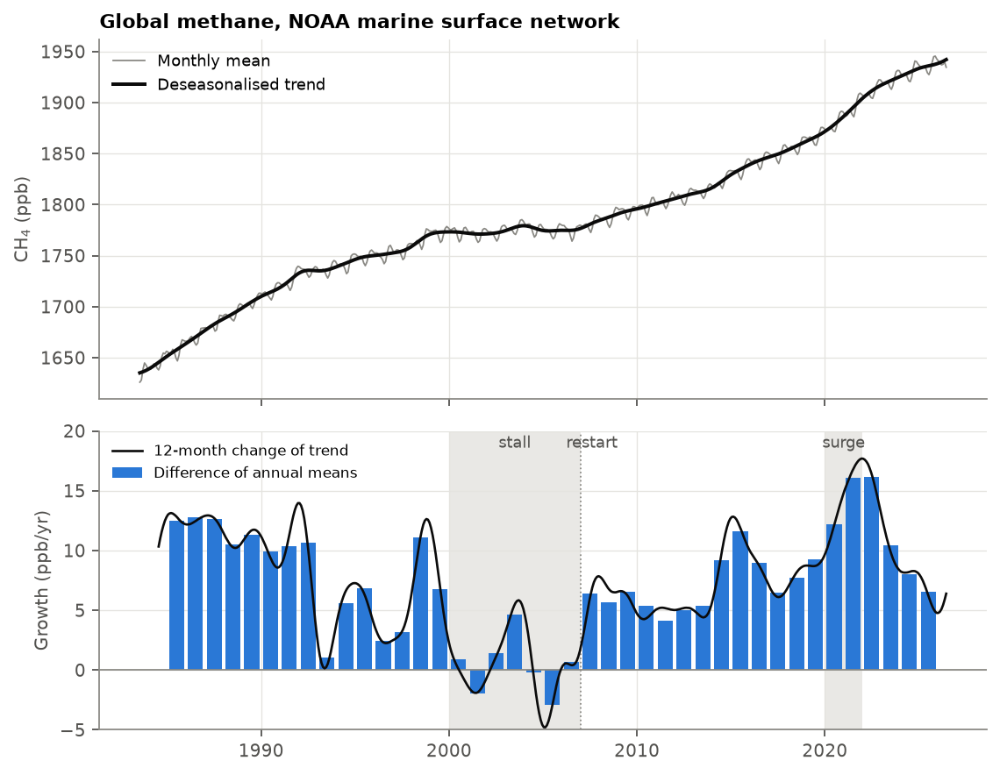

# Why Is Methane Rising Again?

A methane–OH box model of recent methane trends and the Global Methane Pledge. Course project for EH-605 Modeling Earth System and Sustainability, IIT Gandhinagar.

Atmospheric methane almost stopped growing between 2000 and 2006, started rising again in 2007, and hit record growth in 2020–21. Emission inventories don't show any of this. This project fits a set of simple box models to the NOAA record (1984–2025) to work out what's going on, and then uses the best one to look at the Global Methane Pledge.



## What I found

- A one-box model with a constant ~9-year lifetime misses the record by 21 ppb and shows no stall.
- Methane uses up OH, its main sink. This feedback stretches the lifetime of an extra pulse of methane from 9.3 to 12.7 years. On its own, though, the feedback makes the fit worse.
- Letting OH respond to NOx and CO emissions and to temperature brings the error down to 3 ppb. In that model, rising NOx helps explain the stall, and the drop in NOx during COVID explains about half of the 2020–21 surge.
- No tipping point: the system has one stable equilibrium at any realistic emission rate.
- Meeting the Global Methane Pledge lowers methane by about 330 ppb and warming by about 0.05 K by 2050. An optimal-control run in GEKKO puts the best cut at about 35 % (for $1600/t), close to the pledge's 30 %.

The full write-up is in [`report/report.pdf`](report/report.pdf).

## Running it

You need [uv](https://docs.astral.sh/uv/) and Python 3.12.

```
uv run scripts/download_data.py     # download and check all data (~27 MB, once)
uv run scripts/run_all.py --fresh   # run every step, takes about 2 minutes
```

Figures go to `figures/` and numbers to `results/*.json`.

## What's in here

| Path | Contents |
|---|---|
| `scripts/01–09_*.py` | One script per step: data, one-box model, CH₄–OH theory, model fits, two-hemisphere model, forcing and warming, scenarios and the pledge, GEKKO abatement, India |
| `analysis/` | Shared code: data loaders, the box models, the fitting, the scenario paths |
| `data/` | Downloaded data plus a [README](data/README.md) on every source |
| `report/` | `report.pdf` is the submitted 10-page report; `complete_report.pdf` is the longer version with everything |
| `RESULTS.md` | All results in one place, including the parts that didn't make it into the short report |

The two-hemisphere and India steps are in the code and in `complete_report.pdf` but were left out of the short report to keep it within the page limit.

## Data

All data are public. They come from NOAA GML, EDGAR, CEDS, the Global Carbon Project, HadCRUT5, RCMIP and Our World in Data. Sources and licences are listed in [`data/README.md`](data/README.md).

Shardul Junagade (23110297)
